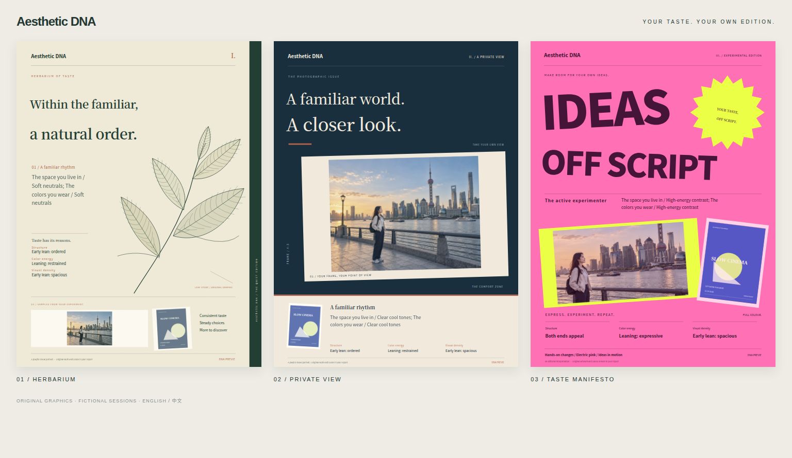
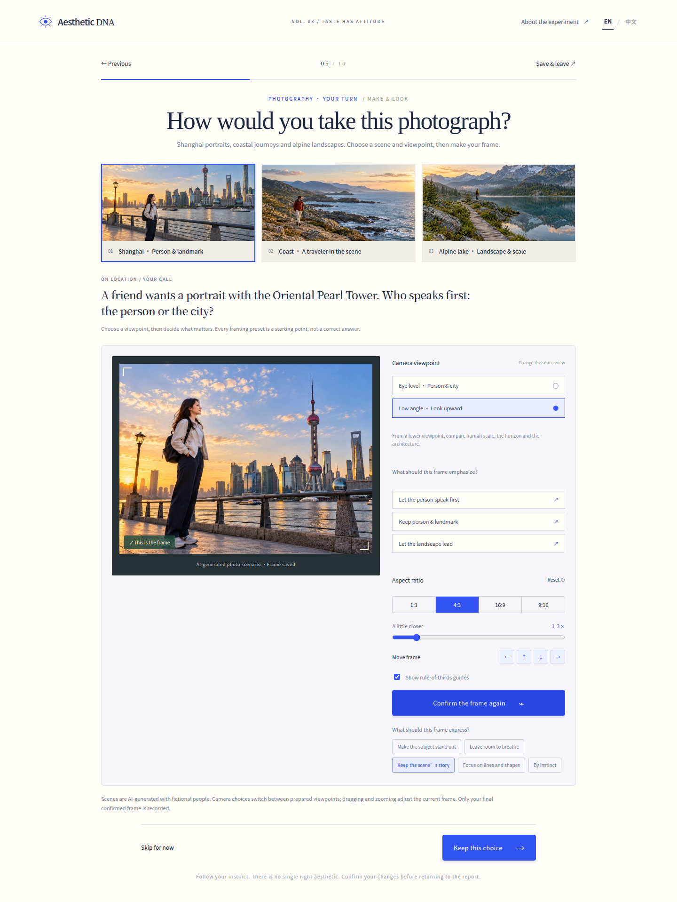

# Aesthetic DNA

**Your eyes. Your rules. Your DNA.**

[Open the live website](https://mikechengx.github.io/aesthetic-dna/) · [简体中文](README.zh-CN.md) · [Architecture](docs/ARCHITECTURE.md) · [Artwork & sources](ASSETS.md)

A playful, browser-based experiment about how you see the world. Choose real movie posters, frame a realistic person or landscape, build a color story and compose a screening poster. Your choices become an evidence-based visual portrait with an editorial card to keep.



## The experience

- **16 movie posters**, referenced from official publishers across France, the US, South Korea and Japan. Filter bold/maximal, clean/quiet, Japanese aesthetics or illustrated worlds. Each session shuffles the wall; keep up to three favorites.
- **16 interactive steps** across composition, architecture, color, typography, fashion and texture. About 6–10 minutes.
- **Photography on location:** choose Shanghai portraits by the Oriental Pearl Tower, a coastal traveler or an alpine lake. Switch between eye-level and low-angle Shanghai source views, choose a framing intention, then crop your own shot. All four source images are AI-generated with fictional people and bundled for offline exports. See [Photography scenes & prompts](docs/PHOTOGRAPHY.md).
- **A closer look:** nine preference questions now have an optional, question-specific explanation. Repeated interests personalize your report without adding extra axis votes.
- **Make things:** crop a scene, build a three-color palette, arrange a poster and restyle an outfit. Includes 38 colors, custom HEX input and eight palette starting points.
- **A portrait with reasons:** compare color choices across living spaces, outfits and posters; inspect the actual scene, viewpoint, retained frame area and color proportions. Recurring self-reported interests change headlines, card copy and next experiments. Preferences, creative focus and working approach link back to actual choices. Skips and unconfirmed drafts do not invent evidence.
- **Three editorial card systems:** botanical Herbarium, photographic Private View and expressive Taste Manifesto, using a coherent palette matched to the session.
- **English first, Chinese one click away.** The top-right language switch updates questions, reports, artwork labels and exports without losing progress.
- **Local by design:** no login, API key or backend. Export your card and artworks as PNG, and the complete report as Markdown.

The report is a playful interpretation of this experiment, not a validated personality test, creativity score or aesthetic ranking. Bright colors alone never imply creativity; active changes to creations are considered separately.



## Run locally

Use Node.js **22.18+**; Node.js 24 is used in CI.

```sh
npm ci
npm run dev
```

Open the local address printed by Vite, usually `http://127.0.0.1:5173`.

```sh
npm run build
npm run preview
```

`dist/` is a static build that can be deployed to a static host. `dist/审美DNA.html` embeds the app code, styles, favicon and original SVG artwork in one file. Official movie posters still require a network connection; if a preview fails, the title and official source link remain available. The regular `dist/index.html` should be served over HTTP.

No environment variables or secrets are required.

## Project structure

```text
src/
  App.tsx                  Navigation, session lifecycle and dialogs
  components/              Shared interface and color controls
  features/
    home/                  Landing experience
    posters/               Catalog filtering, seeded shuffle and poster wall
    experiment/            Question flow and four making studios
    report/                Evidence, creative portrait and card preview
  i18n/                    Locale context, English copy and report presentation
  styles/                  Responsive interface and editorial treatments
  questionDetails.ts       Nine optional follow-ups and stable reason identifiers
  photoScenarios.ts        Photo scenes, camera sources and framing presets
  reportInsights.ts        Context comparisons and personal creation observations
  assets/photos.json       Four bundled AI-generated photographic sources
  content.ts               Questions, semantic options and color stories
  posters.ts               Official poster URLs, credits and style metadata
  core.ts                  Session types, geometry and evidence-based rules
  cardProfile.ts           Card classification and palette selection
  cardDesigns.ts           Three original SVG editorial layouts
  art.ts                   Original stimuli, artwork and card SVG generation
  storage.ts               IndexedDB persistence and recovery backup
  export.ts                PNG and bilingual Markdown downloads
scripts/                   Single-file build packaging
tests/                     Domain, localization and browser regressions
```

See [Architecture](docs/ARCHITECTURE.md) for the state flow and extension points.

## Validate

```sh
npm test
npm run build
npm run format:check
```

For browser tests, leave the development server running on port 5173 and run in a second terminal:

```sh
npx playwright install chromium
npm run test:e2e
```

A system Chrome/Chromium is used when available; `CHROME_PATH` can override its location. The browser suite covers the complete Chinese and English experiences, language switching during editing, refresh recovery, poster filters, mobile overflow, downloads, revision, practice copies and local deletion. Test images and downloads are written to ignored `test-results/`. Poster requests in automated flows use a clearly labeled original fixture, so publisher availability cannot break CI. Live poster URLs were checked separately in Chrome.

## Data and privacy

Answers and lightweight artwork parameters stay in this browser using IndexedDB plus a localStorage recovery backup. The current language preference is also stored locally. There is no analytics, answer upload, cloud account or server-side processing. Publisher-hosted poster requests expose the usual network request information to those hosts; poster previews use a no-referrer policy. Source links open the official publisher sites.

Only the latest experiment is retained. Export before starting again. Clearing site data or changing browsers can remove or isolate your progress. A report URL is local navigation, not a public share link.

## Artwork and current scope

The photography exercise uses four AI-generated realistic images, with fictional people, across three scenes. Camera controls switch between prepared viewpoints; pan and zoom crop the active source. This version does not render an interactive 3D world or infer composition quality with image recognition. Earlier illustrated frames remain available in saved sessions. Other experiment illustrations, botanical graphics and editorial layouts are original SVG compositions. Reference crops are predefined alternative framings.

Movie posters belong to their respective rights holders. This repository stores metadata and official image links, **not copies of movie poster binaries**, and does not grant rights to redistribute or commercially reuse them. Film origin labels identify the film, not a claimed poster edition or aesthetic score. Source details are in [ASSETS.md](ASSETS.md).

The README preview uses fictional test sessions and original graphics and AI-generated fictional photographic scenes only; it does not contain third-party movie posters or real user data.
